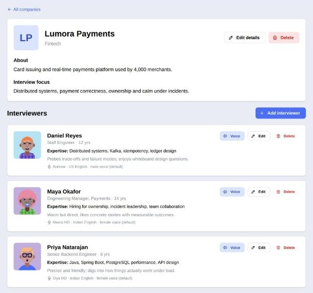
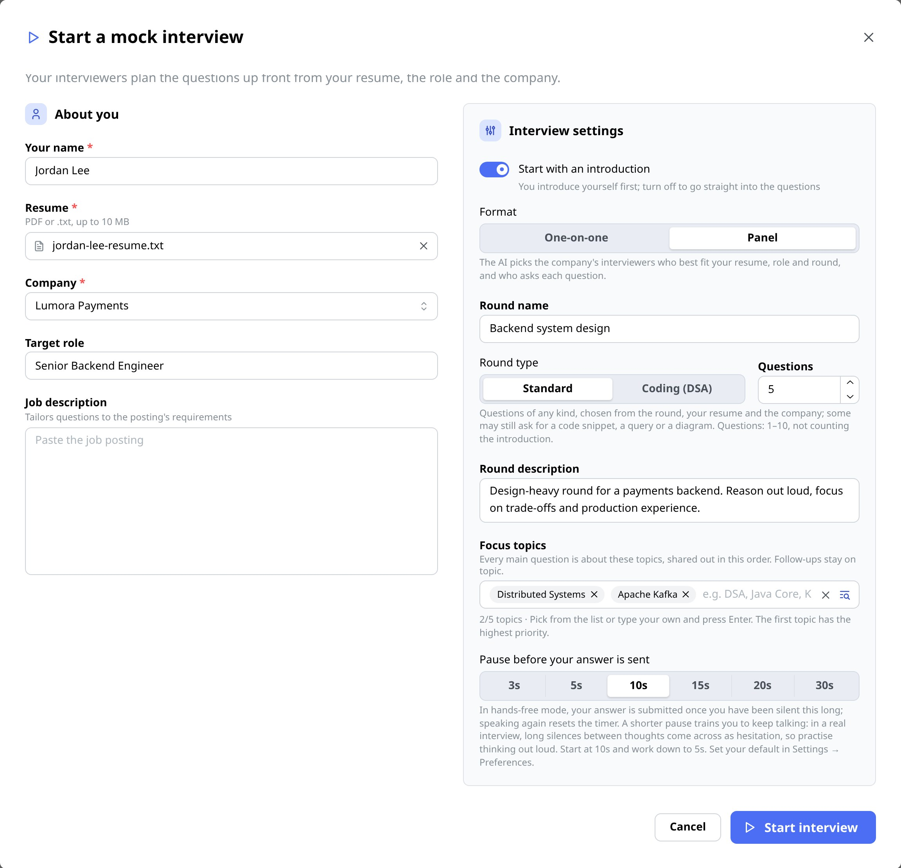
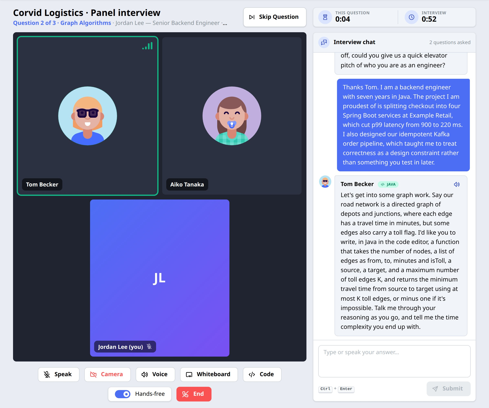
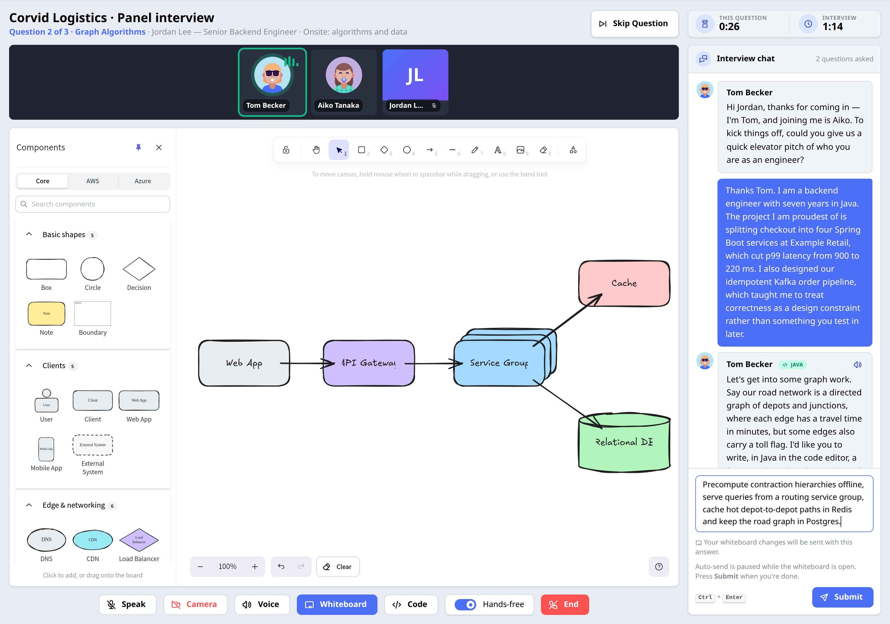
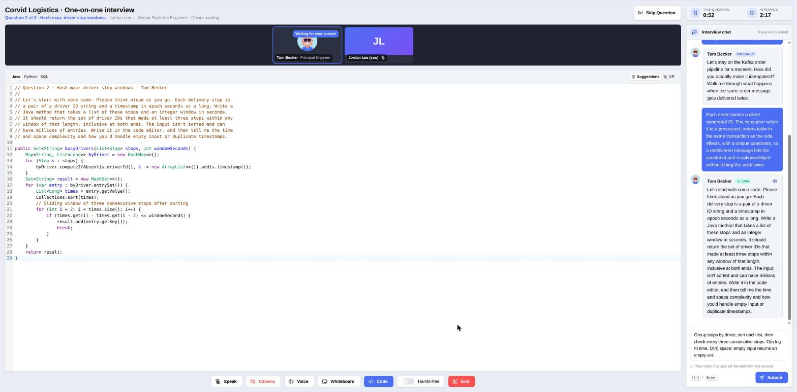
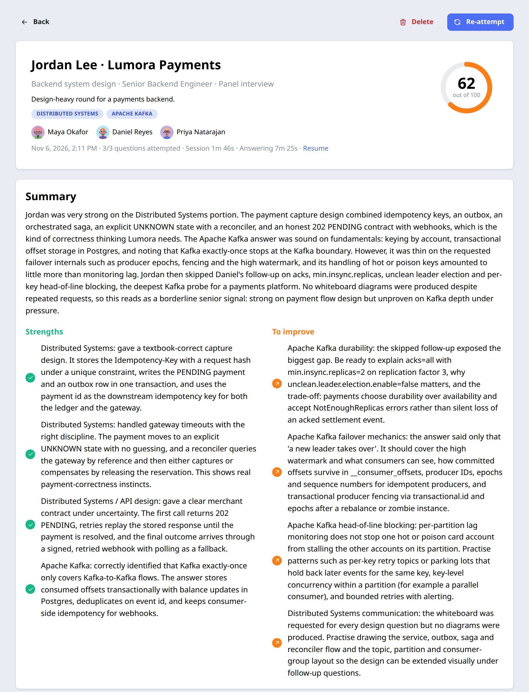
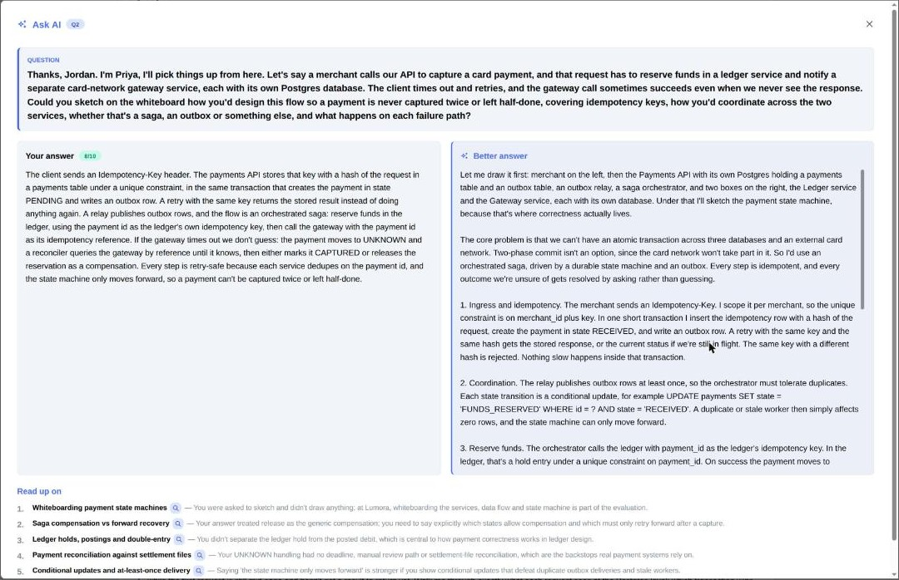
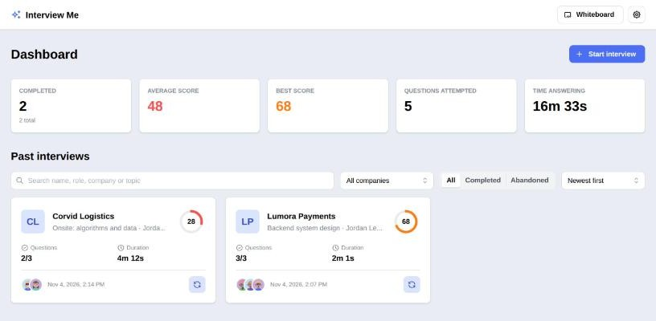
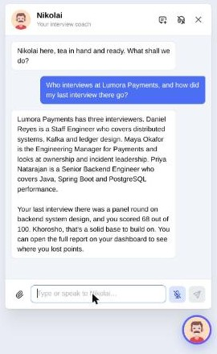
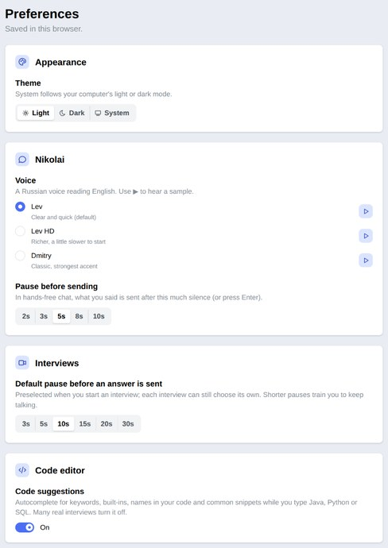

# Interview Me

**AI mock interviews that feel like the real thing.** Set up the companies you're targeting and their interviewer
panels, upload your resume, and step into a video-call style room where AI interviewers ask you questions out loud,
dig into your answers with follow-ups, ask you to sketch designs on a shared whiteboard or write code in a shared
editor, and finish with a scored, hiring-committee style report and a personal study guide.

> [!WARNING]
> **Vibe-coded: use with care.** This project was built largely by prompting an AI coding assistant, not through a
> conventional design-and-review process. It has automated tests, but it has not been security-audited, load-tested or
> reviewed for production use. Expect rough edges and bugs. It is meant for **local, personal use** on your own
> machine: the API has no authentication, so don't expose it to a network.
>
> Things to keep in mind:
> - **Cost:** every interview makes several paid calls to your AI provider (Anthropic or OpenAI). Keep an eye on your
>   usage. Voice uses Azure AI Speech: create it on the **free (F0) tier**, which should be enough for personal practice
>   and costs nothing (it has monthly limits; past them, speech stops working until the next month rather than
>   charging you).
> - **Your data:** your resume, job descriptions and answers are sent to your AI provider to run the interview, and
>   stored unencrypted in a local database (`backend/data/`).
> - **AI feedback is not ground truth:** scores, feedback and model answers come from a language model and can be
>   wrong or inconsistent. Treat them as practice aids, not as a prediction of how a real interview will go.
>
> Provided as is, without warranty (see [LICENSE](LICENSE)). Review the code before relying on it.

## Features

All screenshots use fictional demo companies, interviewers and a fictional candidate.

### Companies and interviewer personas

Add the companies you're preparing for, each with what its interviews focus on, and a panel of interviewers with their
own title, seniority, expertise, interviewing style, voice and photo. For each interview the AI reads your resume, the
role, the job description and the round, picks the best-fitting interviewers from the company and decides who asks
what. The lead asks your introduction, and each topic goes to whoever knows it best.



### Rounds and focus topics

Upload your resume, pick the company and format, choose a standard round or a coding (DSA) round (2 algorithm
problems by default, solved in the code editor), how many questions and whether to start with an introduction, name
the round you're practising (say "Onsite: system design"),
describe how it runs, and optionally restrict it to focus topics (one per main question at most, up to 8) from a
built-in catalog or your own. You get a per-topic breakdown at the end. Every main question is written before you
start, so a reattempt can ask exactly the same ones; after each answer the interviewer scores it and either probes
deeper with a follow-up or moves on.



### Video-call interview room, hands-free

One-on-one or panel layouts, a live transcript, per-question and total timers, skip, and end at any time.
Interviewers speak their questions (Azure AI Speech, a distinct voice each). Answer by voice and your answer is sent
after a pause you choose (3 to 60 s), so you practise talking without long silences. Typing always works too.



### Shared whiteboard

An Excalidraw board with a palette of system-design components, plus the official AWS and Azure architecture icons
once you import them (see [Third-party assets](#third-party-assets)). Your drawing goes to the interviewers with your
answer, and they read it together with what you said.



### Code editor

Write Java, Python or SQL (CodeMirror, with highlighting and optional autocomplete) when a question calls for code.
The question sits at the top of the editor as a comment, your code goes to the interviewers with your answer, and
follow-ups can ask you to change it.



### Detailed report

An overall score out of 100, a summary, strengths, things to improve, per-topic min/max/last scores, and every
question with your answer (and drawing or code), its score and feedback.



### Ask AI study guides

On any question, see your answer next to a first-person model answer built from your resume, plus a prioritised
reading list tied to the gaps in your answer.



### Dashboard and reattempts

Every past interview with its score, questions attempted and time spent. Retake any interview with the same questions
and compare scores with your previous attempt, question by question.



### Nikolai, your coach

A friendly in-app assistant (a Russian career coach persona, voiced) who can list and add companies and interviewers,
look up past interviews and resumes, and start an interview for you, by chat or voice.



### Preferences

Light or dark theme, Nikolai's voice, the hands-free pauses and code suggestions, saved in your browser.



### And also

- **MCP server.** The same actions Nikolai uses are exposed over the Model Context Protocol, so Claude Code or any MCP
  client can drive the app.
- **Choice of AI provider.** Anthropic Claude (default) or OpenAI, including OpenAI-compatible servers such as a local
  Ollama or vLLM.
- **Private by design.** Everything (companies, interviews, resumes) stays in a local database on your machine. The
  camera preview never leaves the browser, and API keys stay on the backend.

**New here? Read the [User guide](docs/USER_GUIDE.md)** for a step-by-step walkthrough.

## Quick start

### Prerequisites

- Java 21 and Maven 3.8+
- Node.js 20.19+ (or 22.12+) and npm
- An API key for [Anthropic](https://console.anthropic.com/) (default) or [OpenAI](https://platform.openai.com/)
- Optional, for voice: an [Azure AI Speech](https://learn.microsoft.com/azure/ai-services/speech-service/) resource
  on the **free F0 tier**, which should be enough for personal use

### Run

```bash
git clone https://github.com/amitt00r/interview-me.git
cd interview-me
export ANTHROPIC_API_KEY=sk-ant-...         # required (or use OpenAI, see Configuration)
export AZURE_SPEECH_KEY=...                 # optional, enables voice
export AZURE_SPEECH_REGION=eastus           # optional, the Speech resource's region

./start.sh                                  # Linux and macOS
# start.cmd, or .\start.ps1 from PowerShell  # Windows
```

The start script starts the backend, waits until it answers, then starts the frontend; Ctrl+C stops both. Open
**http://localhost:5173**. Backend output goes to `logs/backend.log`.

Or run the two halves yourself:

```bash
cd backend && mvn spring-boot:run           # http://localhost:8080
cd frontend && npm install && npm run dev   # http://localhost:5173, proxies /api to the backend
```

The app starts empty: add a company and its interviewers first (see the [User guide](docs/USER_GUIDE.md#1-set-up-a-company-and-its-interviewers)).

## Configuration

Settings live in `backend/src/main/resources/application.yml` and are read from environment variables.

### AI provider

`app.ai.provider` selects the provider, and only that provider's block is used. The backend refuses to start if the
selected provider has no API key.

```yaml
app:
  ai:
    provider: anthropic        # anthropic | openai
    anthropic:
      api-key: ${ANTHROPIC_API_KEY:}
      model: ${ANTHROPIC_MODEL:claude-opus-5-5}
    openai:
      api-key: ${OPENAI_API_KEY:}
      base-url: ${OPENAI_BASE_URL:}   # e.g. http://localhost:11434/v1 for Ollama
      model: ${OPENAI_MODEL:gpt-5.1}
```

To use OpenAI on your machine without editing the main file, use the `local` profile, which switches to OpenAI:

```bash
export OPENAI_API_KEY=sk-...
cd backend && mvn spring-boot:run -Dspring-boot.run.profiles=local
```

| Property | Default | Meaning |
|---|---|---|
| `app.ai.provider` | `anthropic` | `anthropic` or `openai` |
| `app.ai.<provider>.api-key` | `ANTHROPIC_API_KEY` / `OPENAI_API_KEY` | API key of the selected provider (required) |
| `app.ai.<provider>.base-url` | provider's public API | A proxy, or any OpenAI-compatible server (`ANTHROPIC_BASE_URL` / `OPENAI_BASE_URL`) |
| `app.ai.openai.organization` | none | OpenAI organization (`OPENAI_ORG_ID`) |
| `app.ai.<provider>.model` | `claude-opus-5-5` / `gpt-5.1` | Model id (`ANTHROPIC_MODEL` / `OPENAI_MODEL`) |
| `app.ai.<provider>.turn-effort` | `low` | Effort for choosing the panel, scoring each answer and Nikolai (latency-sensitive). Leave blank for models without reasoning effort |
| `app.ai.<provider>.final-effort` | `medium` | Effort for planning the questions, the final evaluation and study guides |
| `app.ai.max-questions` | `5` | Default main questions (after the introduction) for a standard interview started without a count, e.g. by Nikolai or MCP; the start dialog lets you choose 1-10 |
| `app.ai.max-follow-ups` | `2` | Follow-ups allowed per main question (coding rounds ignore it: the AI asks as many as each problem needs, up to a safety limit of 12) |
| `app.ai.panel-size` | `3` | Interviewers on a panel (capped by the company's interviewer count, minimum 2) |

The prompts are written for Claude; other models work but may phrase and score differently.

### Voice

Voice uses [Azure AI Speech](https://learn.microsoft.com/azure/ai-services/speech-service/). In the Azure portal,
create a **Speech** resource and pick the **Free F0** pricing tier: it should comfortably cover personal practice,
and you aren't charged. The free tier has monthly limits on speech-to-text hours and text-to-speech characters (see
[Speech pricing](https://azure.microsoft.com/pricing/details/cognitive-services/speech-services/)); if you hit them,
voice stops until the next month and the room still works by typing. You can have one free Speech resource per
subscription. Copy its key and region from **Keys and Endpoint**:

| Variable | Meaning |
|---|---|
| `AZURE_SPEECH_KEY` | Azure AI Speech key. Without it the room runs text-only |
| `AZURE_SPEECH_REGION` | The Speech resource's region, e.g. `eastus` |

The key stays on the backend; the browser only receives short-lived tokens from `GET /api/speech/token`.

### Data and storage

| What | Where |
|---|---|
| Database (companies, interviewers, interviews, resumes) | H2 file in `backend/data/` (delete the folder to reset) |
| Interviewer photos | `backend/data/uploads/` (`app.uploads.dir`) |
| Company logos | Any image URL, or a file you place in `frontend/public/companies/` and reference as `/companies/<file>` |

`backend/data/` and `frontend/public/companies/` are git-ignored, so your interviews, resumes and logos are never
committed.

## Use with Claude Code (MCP)

The backend serves an MCP server at `/mcp` (local connections only) with tools to list and add companies and
interviewers, list interviews and resumes, read a resume, and start an interview:

```bash
claude mcp add --transport http interview-me http://localhost:8080/mcp
```

## Development

```bash
cd backend && mvn test              # backend tests (in-memory H2, AI mocked)
cd frontend && npm run typecheck    # TypeScript checks
cd frontend && npm run build        # production build
```

To run a second frontend against another backend (for example a demo instance), set `BACKEND_URL`:
`BACKEND_URL=http://localhost:18080 npx vite --port 5174`.

Project layout:

- `backend/`: Java 21, Spring Boot 3.5, Spring Data JPA, H2, Anthropic and OpenAI Java SDKs, MCP Java SDK, PDFBox
- `frontend/`: React 19, TypeScript, Vite, Mantine, Excalidraw, CodeMirror, Azure Speech SDK

[`CLAUDE.md`](CLAUDE.md) documents the architecture in depth: the interview state machine, how prompts are built,
the whiteboard, the code editor, and so on.

## Third-party assets

The whiteboard's AWS and Azure tabs use the official
[AWS Architecture Icons](https://aws.amazon.com/architecture/icons/) and
[Azure Public Service Icons](https://learn.microsoft.com/azure/architecture/icons/). Their terms cover creating
architecture diagrams, not republishing the icon sets, so **they are not included in this repository**. To enable those
tabs, download both packages and run the import script (two minutes; steps in
[`frontend/public/whiteboard-icons/README.md`](frontend/public/whiteboard-icons/README.md)):

```bash
cd frontend && python3 -I scripts/import-cloud-icons.py <unzipped AWS dir> <unzipped Azure dir>
```

The Core components work without them. Interviewer avatars are generated with [DiceBear](https://www.dicebear.com/).

## License

[MIT](LICENSE)
