# User guide

This guide walks through Interview Me from an empty install to your first report. It assumes the app is running at
http://localhost:5173 (see [Quick start](../README.md#quick-start)).

All screenshots use fictional demo companies, interviewers and a fictional candidate.

- [1. Set up a company and its interviewers](#1-set-up-a-company-and-its-interviewers)
- [2. Start an interview](#2-start-an-interview)
- [3. The interview room](#3-the-interview-room)
- [4. Draw on the whiteboard](#4-draw-on-the-whiteboard)
- [5. Write code](#5-write-code)
- [6. Read your report](#6-read-your-report)
- [7. Ask AI for a better answer](#7-ask-ai-for-a-better-answer)
- [8. Reattempt and track progress](#8-reattempt-and-track-progress)
- [9. Nikolai, your coach](#9-nikolai-your-coach)
- [10. Preferences](#10-preferences)
- [11. Tips](#11-tips)
- [Troubleshooting](#troubleshooting)

---

## 1. Set up a company and its interviewers

Interviews always happen at a company, run by that company's interviewers, so start here. Open the gear menu in the
header and choose **Companies**, then **Add company**.

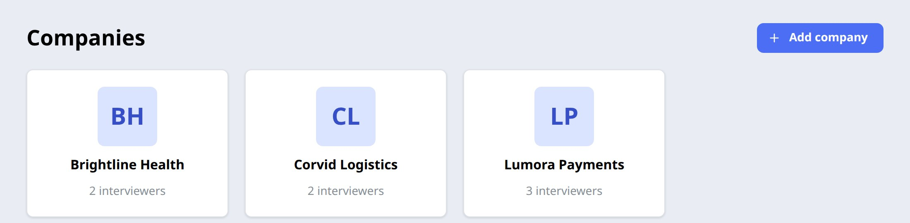

Give the company:

- **Name** and **industry**.
- **About**: a sentence or two on what it does. Interviewers use it for context.
- **Interview focus**: what its interviews care about, for example "distributed systems, payment correctness,
  ownership". This shapes every question.
- **Logo URL** (optional): any image URL, or `/companies/<file>` for a file you put in `frontend/public/companies/`.
  Initials are shown otherwise.

Open the company and add its interviewers with **Add interviewer**. Each interviewer is a persona:

- **Name, title and years of experience**: seniority changes how they ask.
- **Expertise**: what they know best. The AI uses this to choose who sits on your panel and who asks which question.
- **Background and style**: how they interview, for example "Socratic; asks you to reason out loud".
- **Voice** (optional): pick one and press **Voice** to hear it. Otherwise a voice matching the first name is chosen.
- **Photo** (optional): upload one when editing; otherwise an illustrated avatar is generated.

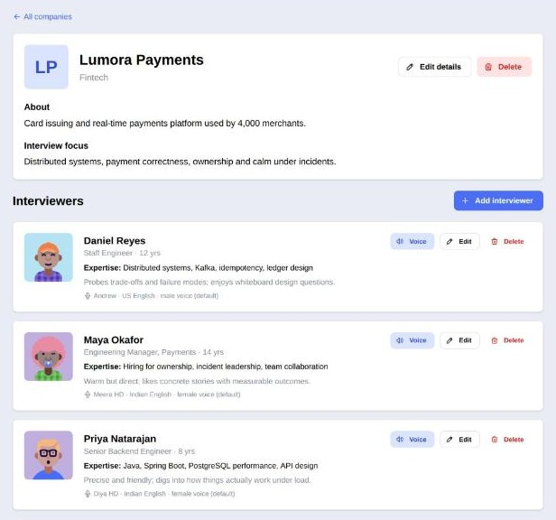

Add at least one interviewer for one-on-one interviews and two or more for panels. A richer roster (a hiring manager,
a staff engineer, a specialist or two) gives the AI more to choose from.

> Tip: Nikolai can do this for you. Ask him "add Stripe with three interviewers" and he fills in sensible details.
> See [section 9](#9-nikolai-your-coach).

## 2. Start an interview

On the **Dashboard**, press **Start interview**.

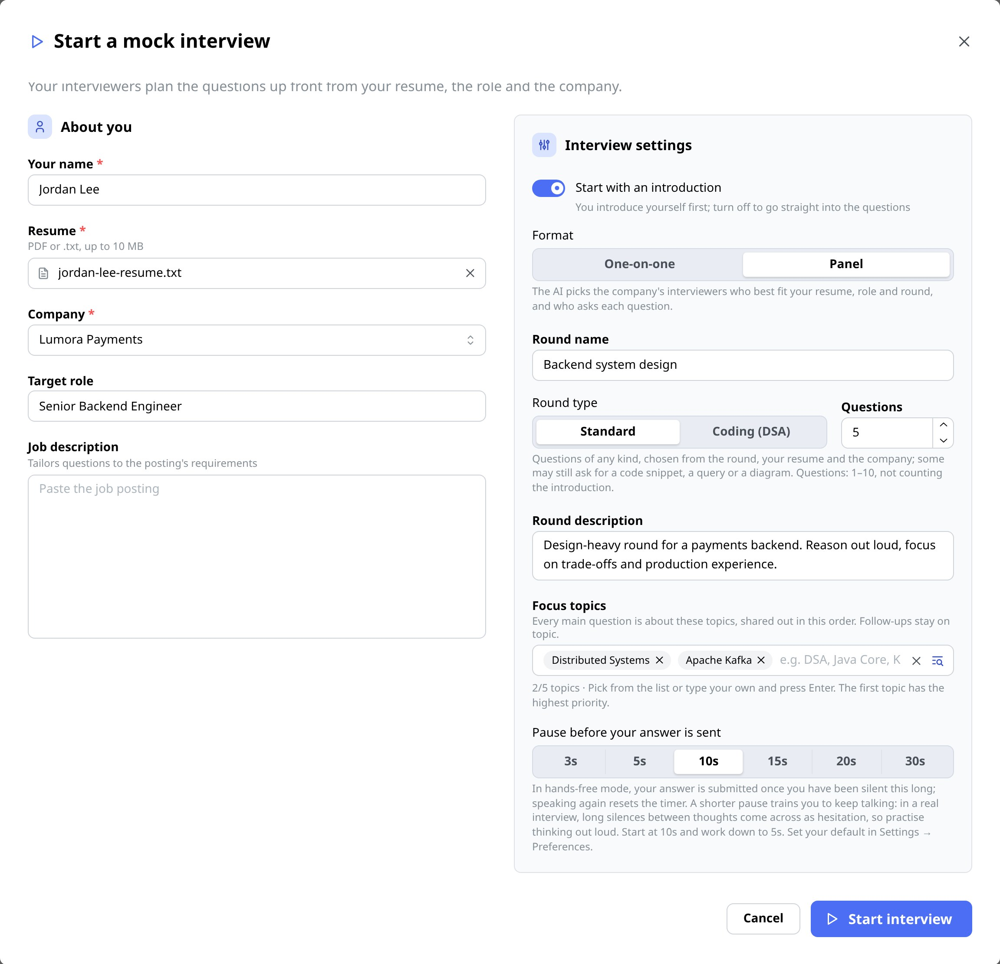

**About you**

- **Your name** and **resume** (PDF or plain text, up to 10 MB). Questions are grounded in your resume.
- **Company**: only companies with interviewers are listed.
- **Target role** (optional): inferred from the job description or resume if empty.
- **Job description** (optional): paste the posting and questions are tailored to its requirements, including gaps
  between it and your resume.

**Interview settings**

- **Format**: one-on-one, or a panel (up to `panel-size` interviewers, 3 by default).
- **Round name and description** (optional): what you want to practise, for example "Onsite: system design, focus on
  trade-offs, no puzzles".
- **Focus topics** (optional): in priority order, at most one per main question (5 by default, never more than 8). Type your own or press the list button to browse the catalog
  by category. With topics, every main question is about one of them and the report breaks your score down by topic.
  Without them, the round, your resume and the company decide.
- **Pause before your answer is sent**: in hands-free mode, how long you can be silent before your answer is submitted.
  Start around 10 s and work down. Shorter pauses train you to keep talking, as you would in a real interview.

Press **Start interview**. It takes a few seconds while the AI:

1. **Chooses your interviewers** from the company's roster, based on your resume, the role, the job description and the
   round. It picks the lead (who asks your introduction) and gives each question to the best-placed interviewer.
2. **Plans every question up front**: an introduction, then the main questions (5 by default).

## 3. The interview room

You land in a lobby. Your camera preview is shown, but it stays on your device and is never recorded. Press
**Join interview** (this click also allows the browser to play the interviewers' voices).

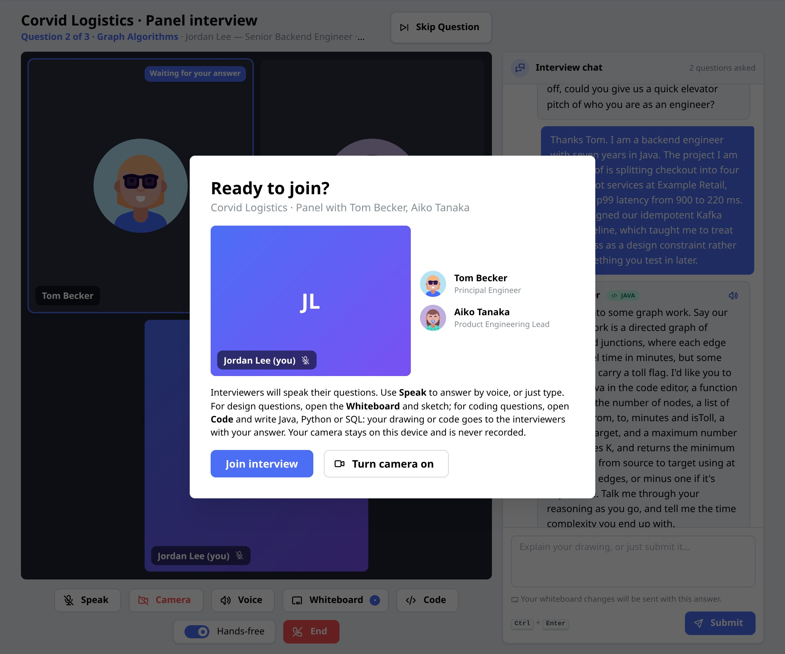

The room looks like a video call: the interviewers on the left, and the conversation on the right.

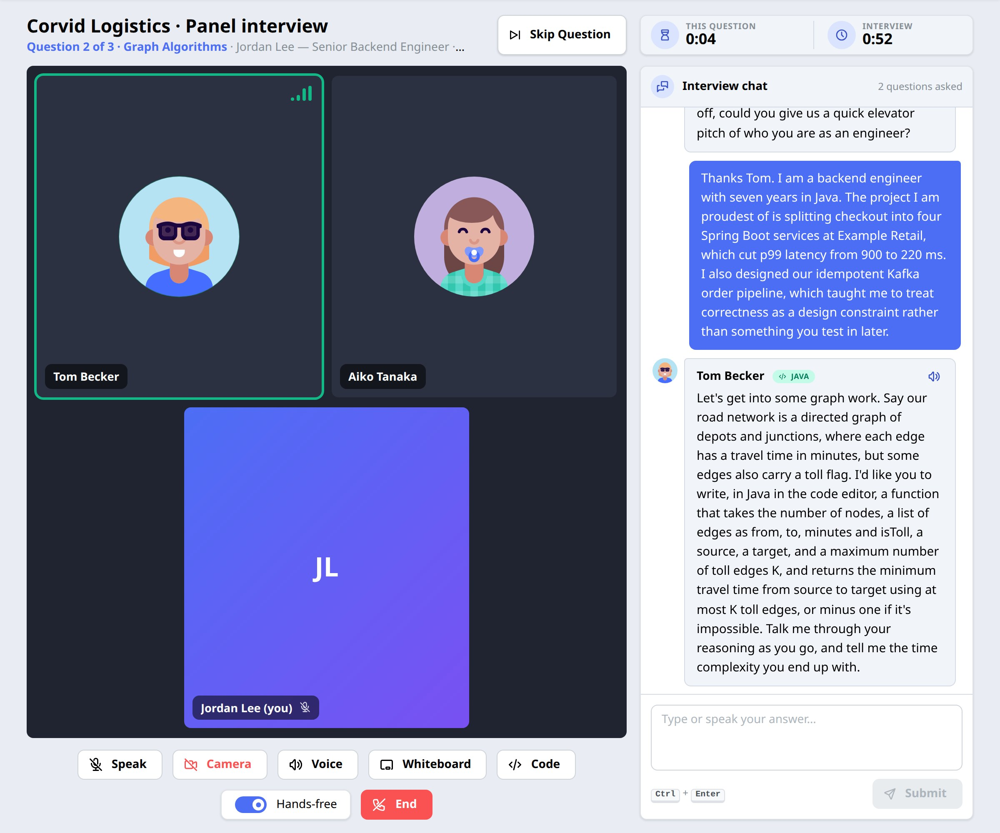

- The interviewer asking the current question is highlighted and **speaks it** (when voice is configured). The question
  also appears in the chat, and the header shows which question you're on and its topic.
- **Answer** by typing in the box and pressing **Submit** (or Ctrl+Enter), or by voice:
  - **Hands-free** (on by default): the mic opens after each question, and your answer is sent once you've been silent
    for your chosen pause. A countdown appears for the last few seconds; speaking again resets it.
  - **Speak**: click to dictate into the box yourself, then submit when ready.
- After each answer the interviewer either asks a **follow-up** that probes what you said (up to 2 per question) or
  moves to the next planned question, often handing over to a colleague on a panel.
- **Skip Question** moves on (it scores 0). **End** finishes early; you're still evaluated on what you answered.
- The timers show time on this question and in the whole interview. Only time in the room counts.
- **Voice** mutes or unmutes the interviewers, and **Camera** toggles your local preview.

The interview ends by itself after the last planned question and its follow-ups.

## 4. Draw on the whiteboard

For design questions the interviewer will ask you to draw, and the whiteboard opens automatically. You can also press
**Whiteboard** at any time. The room widens and the interviewers shrink to a strip at the top.

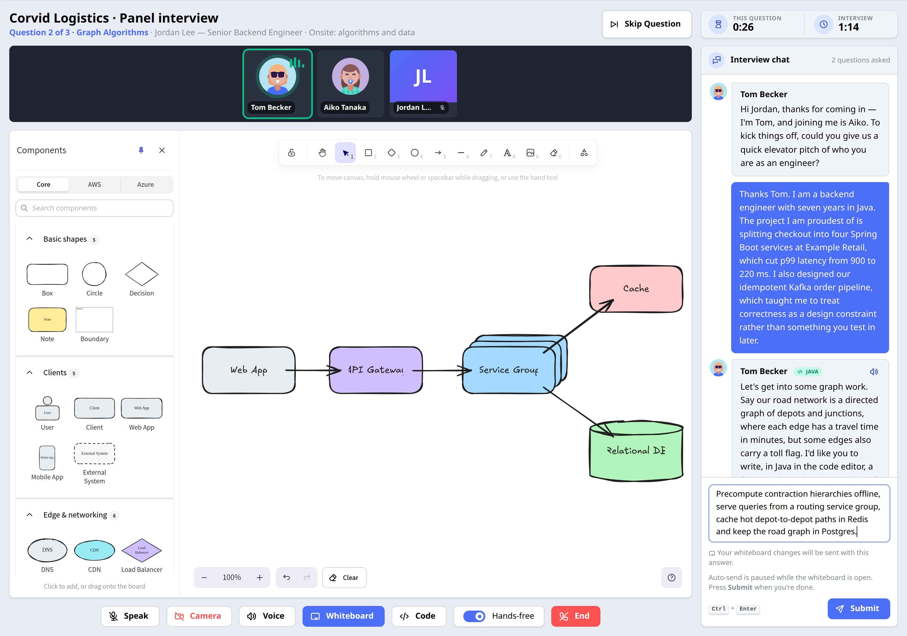

- The **Components** palette on the left has three tabs:
  - **Core**: basic shapes plus system-design building blocks (clients, gateways, load balancers, services, queues,
    caches, databases and more).
  - **AWS** and **Azure**: the official architecture icons. They aren't shipped with the app; until you import them
    (see [Third-party assets](../README.md#third-party-assets)) these tabs show how.

  Search the palette, then click a component to drop it in the middle of the board, or drag it where you want it.
- Connect components with the arrow tool (press `a`). Arrows stick to the components they connect.
- Explain your design in the answer box and **Submit**. A drawing on its own is also a valid answer.
- The interviewer receives an image of your board and an outline of its labelled components and connections, and judges
  the drawing and what you said together. Follow-ups can ask you to extend your drawing; the board carries over.
- **Clear** empties the board (undoable). Your board is saved in the browser while you work, so a reload doesn't lose it.

Hands-free auto-send is paused while the board is open, so you can think and draw. Press Submit when you're done.

The **Whiteboard** button in the app header opens a full-window scratch board with the same components, outside any
interview, for practising on your own.

## 5. Write code

For coding questions (implement a function, write a SQL query, fix a snippet) the interviewer will ask you to write
code, and the code editor opens automatically in the language asked for. You can also press **Code** at any time. Like
the whiteboard, it takes the stage and the interviewers shrink to a strip at the top.

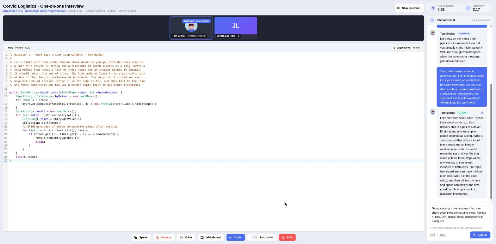

- The question appears at the top of the editor as a comment, so you can read it while you code; a follow-up that
  asks for code is added above it the same way. These comments don't count as changes until you edit.
- Pick **Java**, **Python** or **SQL** in the editor's toolbar (comments switch to the new language's syntax); for SQL you can also pick a dialect (Standard,
  PostgreSQL or MySQL), which only changes the keywords suggested.
- **Suggestions** autocomplete as you type: keywords, built-ins, names already in your code and common interview
  snippets (try `for`, `main`, `HashMap`, `def`, `listcomp` or `import collections`). Real interviews often have no
  autocomplete, so you can turn it off with the toolbar switch or on the **Preferences** page.
- Talk through your approach in the answer box and **Submit** (or press `Ctrl` + `Enter` in the editor). Code on its
  own is also a valid answer. The interviewer reads your code with what you said and judges correctness, edge cases,
  complexity and readability. The code is never run.
- Follow-ups can ask you to change your code (an edge case, a faster version); the code carries over to them, and
  only code you changed is sent again. It is saved in the browser while you work, so a reload doesn't lose it.

Hands-free auto-send is paused while the editor is open, so you can think and type. Press Submit when you're done.

## 6. Read your report

When the interview ends you're taken to the report. You can also open any past interview from the dashboard.

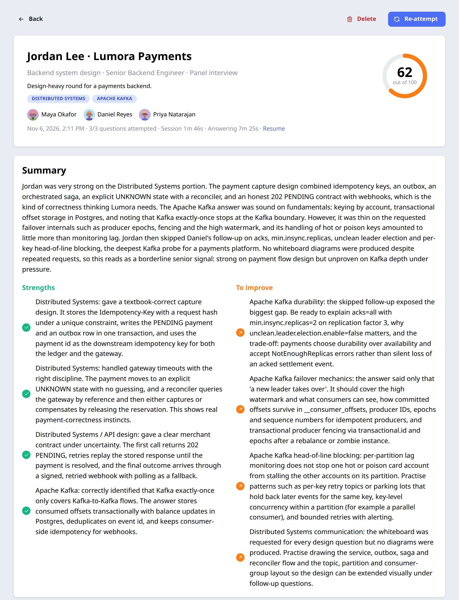

- **Overall score** out of 100, with the round, topics, panel, date, questions attempted, session length and time
  spent answering. **Resume** opens the resume you used.
- **Summary**: a hiring-committee style assessment.
- **Strengths** and **To improve**: specific and actionable, tied to your answers.

Scroll down for the details:

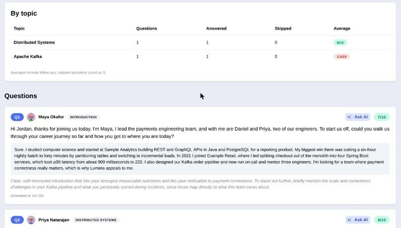

- **By topic** (when the round had focus topics): questions, answered, skipped and the min, max and last score
  per topic, follow-ups included (skips count as 0).
- **Questions**: every planned question with who asked it, your answer (and whiteboard or code, if you used them), its score out of 10
  and feedback, followed by each follow-up. Questions you skipped or never reached are marked as such.

Scores are calibrated like a demanding but fair interviewer: 3 is weak, 5 adequate, 7 strong, 9 to 10 exceptional.

## 7. Ask AI for a better answer

Every question and follow-up in a report has an **Ask AI** button next to its score.

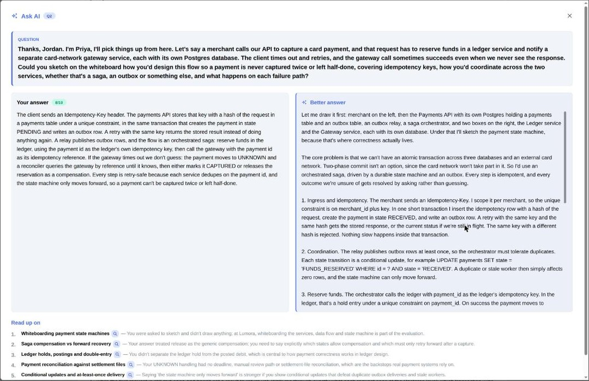

It shows:

- **Your answer** on the left, with your code if you wrote any.
- **A better answer** on the right: what a strong candidate for this role at this company would say, in the first
  person, built from your real experience on your resume (it never invents employers or results). For coding
  questions it includes the code, highlighted.
- **Read up on**: a prioritised list of topics, each tied to a gap in your answer, with a quick search link.

It also works for questions you skipped or never reached. Each guide is generated once and saved with the report.

## 8. Reattempt and track progress

Press **Re-attempt** on a report (or the circular button on a dashboard card) to retake an interview with **exactly the
same questions**, the same panel and the same round. Follow-ups are generated fresh from your new answers. The new
report compares each question's score with your previous attempt.

The **Dashboard** tracks your progress:

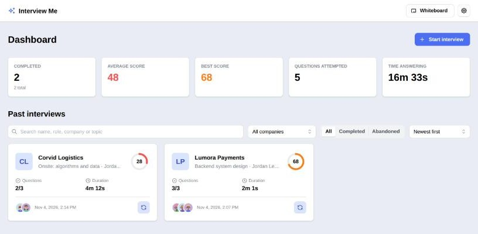

- Totals: completed interviews, average and best score, questions attempted and time spent answering.
- **Past interviews**: search by name, role, company or topic, filter by company or status, and sort. Each card shows the
  score, questions attempted, duration and the panel.
- **Delete** (on the report) removes an interview together with all its reattempts.

## 9. Nikolai, your coach

Nikolai is the friendly face in the bottom-right corner: a Russian career coach who can act inside the app for you.
Press his face to open the chat.

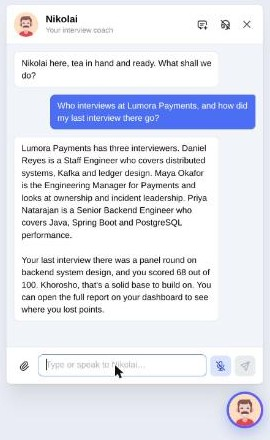

Ask him in plain language, by typing or by voice:

- "What companies do I have?" or "Who interviews at Lumora Payments?"
- "Add Corvid Logistics, a logistics company, with two interviewers."
- "How did my last interview go?"
- "Start a panel interview at Lumora on Kafka and distributed systems." He confirms the details (company, format, round,
  topics and which resume) before starting, then opens the room.

He reuses the resume from your last interview unless you attach a new one with the paperclip.

The **headset** button in his header toggles hands-free. When it's on, he speaks his replies and listens when he
finishes, sending what you say after a short pause. When it's off, he stays quiet and the mic only listens when you
click it. **New chat** starts over.

## 10. Preferences

Open the gear menu and choose **Preferences**. Settings are saved in this browser.

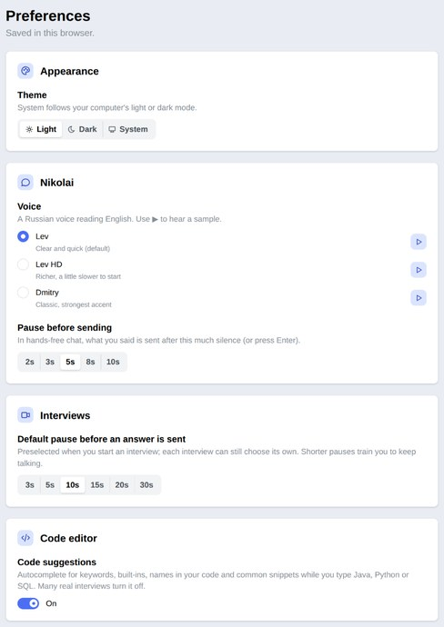

- **Theme**: light, dark, or follow your system.
- **Nikolai's voice**, with a sample button for each, and his hands-free **pause before sending**.
- **Interviews**: the default pause preselected when you start an interview.
- **Code editor**: turn code suggestions (autocomplete) on or off.

## 11. Tips

- **Paste the job description.** It makes questions noticeably more targeted.
- **Use focus topics for weak spots.** One or two topics give you a deep, focused round and a per-topic score.
- **Talk, don't type, when you can.** Hands-free with a short pause is the closest thing to the real pressure.
- **Draw for design questions.** Interviewers expect it, and the feedback notices when you don't.
- **Practise coding without suggestions** once you're comfortable, to match interviews that have no autocomplete.
- **Read Ask AI after every interview,** then **re-attempt** a few days later and compare.

## Troubleshooting

| Problem | Fix |
|---|---|
| Backend won't start: "needs an API key" | Set `ANTHROPIC_API_KEY` (or `OPENAI_API_KEY` with `app.ai.provider: openai`) |
| "AI service rejected the credentials" | The key is set but invalid or out of credit; check it in your provider's console |
| No voices, or no mic | Set `AZURE_SPEECH_KEY` and `AZURE_SPEECH_REGION`, and allow microphone access in the browser. Without them the room is text-only |
| Voice stopped working mid-month | The free (F0) Speech tier's monthly limit was reached; it resets next month. Typing still works |
| A company is missing from the start dialog | It has no interviewers yet. A panel needs at least two |
| Starting an interview takes a while | Choosing the panel and planning the questions are two AI calls; expect several seconds |
| Want a clean slate | Stop the backend and delete `backend/data/` (this deletes all companies, interviews and resumes) |
